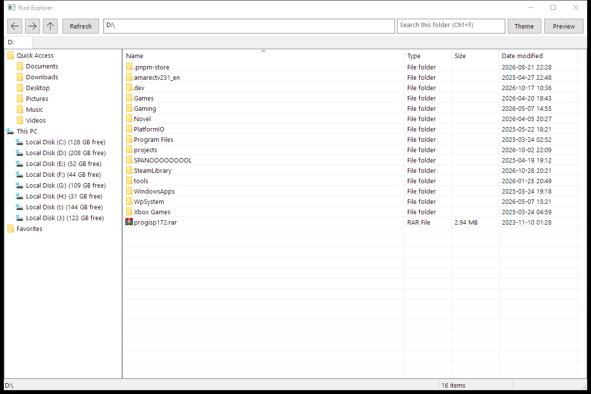
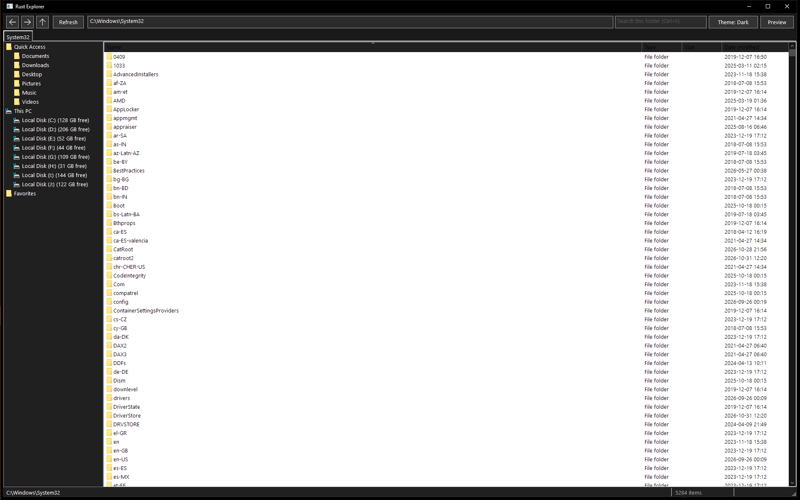
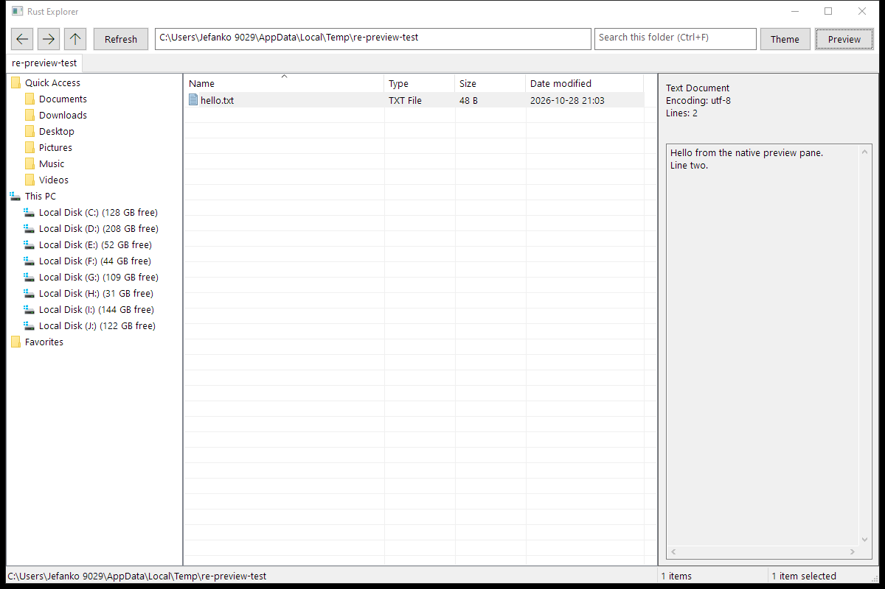

# Rust Explorer

A file manager for Windows, written in Rust against the Win32 API. No web view, no
Electron, no Node at runtime: the shell is a plain `CreateWindowExW` window, the file
list is an owner-data `SysListView32`, and the sidebar is a `SysTreeView32`.

I built this originally as a Tauri app and then replaced the frontend with a native
Win32 host. The old Tauri version is still in `legacy/desktop/` if you want to compare,
but it is no longer part of the default build.

## Status

Usable for everyday browsing. Folder listing, tabs, history, sorting, deep search,
previews and the usual file operations work. The rough edges are listed under
[Known issues](#known-issues).



## Build

You need Windows 10/11 x64, Rust 1.85+ (2024 edition), and the MSVC build tools with
the Windows SDK. If `cargo build` complains about `link.exe`, install Visual Studio
Build Tools and select the "Desktop development with C++" workload.

```powershell
cargo run                      # debug build, keeps a console for log output
cargo build --release          # target\release\rust-explorer.exe
```

The first build compiles the `windows` crate and bundled SQLite, so expect a few
minutes.

Node.js is only needed for the legacy Tauri app and the manifest version check.

## Tests

```powershell
cargo test --workspace
cargo xtask doctor            # toolchain, FTS5, manifest versions
powershell -ExecutionPolicy Bypass -File scripts\measure-memory.ps1
```

Idle working set is around 30 MB on my machine. The script prints the numbers for
yours; it is not benchmarked in CI.

## What it does

**Browsing.** Owner-data list view with shell icons, sortable columns, natural name
sorting and a deep indexed search box. Folders are enumerated with `FindFirstFileExW` and
cached, so scrolling a 100k-entry directory does not hit the disk again.

**Navigation.** Tabs, back/forward/up, and an address bar that accepts `C:\...`,
`%USERPROFILE%` and file paths (a file opens with its default app). Known folders and
drives with free space are in the sidebar; favorites are stored in SQLite.

**File operations.** Create folder, rename, copy, cut, paste and delete. Mutations go
through `IFileOperation` on a dedicated STA thread, and deletes are forced through the
Recycle Bin — Shift+Delete is refused rather than silently deleting permanently.

**Preview.** Text files (UTF-8/UTF-16, 64 KiB cap) and folder item counts. Image files
show format and size; they are not drawn yet.

**Live updates.** The open folder is watched with `ReadDirectoryChangesW` and the view
refreshes after a short debounce.

**Search.** The search box runs a deep filename search across every indexed root using a
bundled SQLite FTS5 trigram index. Results appear in the main table with Name, Location,
Size and Date modified; double-click or Enter opens a hit, and the context menu offers
Open containing folder and Copy path. If no root is indexed, the current folder is
indexed automatically and results update live while the crawl runs. Queries support
`ext:rs`, `type:folder` and `"exact phrases"`; the view shows at most 1,000 matches.

**Dark mode.** A persisted System / Light / Dark preference. System follows the OS
theme; the title bar, toolbar, address/search boxes, list, header, sidebar, tabs,
status bar, preview pane, context menus and dialogs all render dark. Windows 10 has
no native dark theme for the tab strip or status bar, so those are owner-drawn; the
tree uses direct colors. High contrast falls back to system colors, and gridlines are
hidden in dark mode.





## Layout

```
apps/native-win32       Win32 shell: window proc, controls, dialogs, preview
crates/explorer-app     app controller, request/response types, no UI code
crates/explorer-domain  data models, IDs, errors
crates/explorer-fs      enumeration, snapshots, sorting, previews, path policy
crates/explorer-win     Win32 wrappers: COM STA, IFileOperation, clipboard, paths
crates/explorer-jobs    plan -> commit -> execute pipeline and job journal
crates/explorer-index   SQLite FTS5 index, crawler, queries
crates/explorer-watch   ReadDirectoryChangesW service with debounce
crates/explorer-store   SQLite settings and job journal
xtask                   doctor, smoke and bench helpers
legacy/desktop          the old Tauri 2 + React app (reference only)
```

More detail in [ARCHITECTURE.md](ARCHITECTURE.md).

## Troubleshooting

The GUI build has no console, so problems end up in a log file:

```
%LOCALAPPDATA%\RustExplorer\logs\rust-explorer.log
```

It records panics and unhandled exceptions with a resolved stack (debug builds use the
PDB next to the exe). Set `RUST_EXPLORER_TRACE=1` before starting to also log every
window message, which is usually what you need for ordering bugs.

Settings, favorites, the job journal and the search index live in
`%LOCALAPPDATA%\RustExplorer\`. Deleting that folder resets the app; `instance.lock`
there keeps a second launch from opening a second window.

[RUNBOOK.md](RUNBOOK.md) has the longer version, including packaging.

## Known issues

- Internal drag and drop is not implemented. Use clipboard copy/cut/paste.
- Deep search covers indexed filenames only, not file contents.
- The search results view shows at most the first 1,000 matches; refine the query
  beyond that.
- Image preview shows metadata only.
- Scrollbars keep the system theme; Windows draws them outside the control's dark
  theme.
- Indexing a large root (a whole drive) can keep one core busy for a while. Startup
  resumes interrupted crawls but no longer re-crawls healthy roots.

## License

MIT. See [LICENSE](LICENSE).
